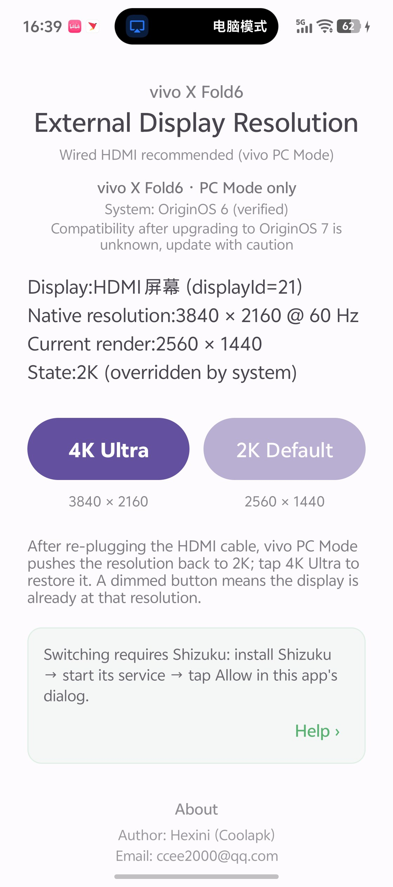
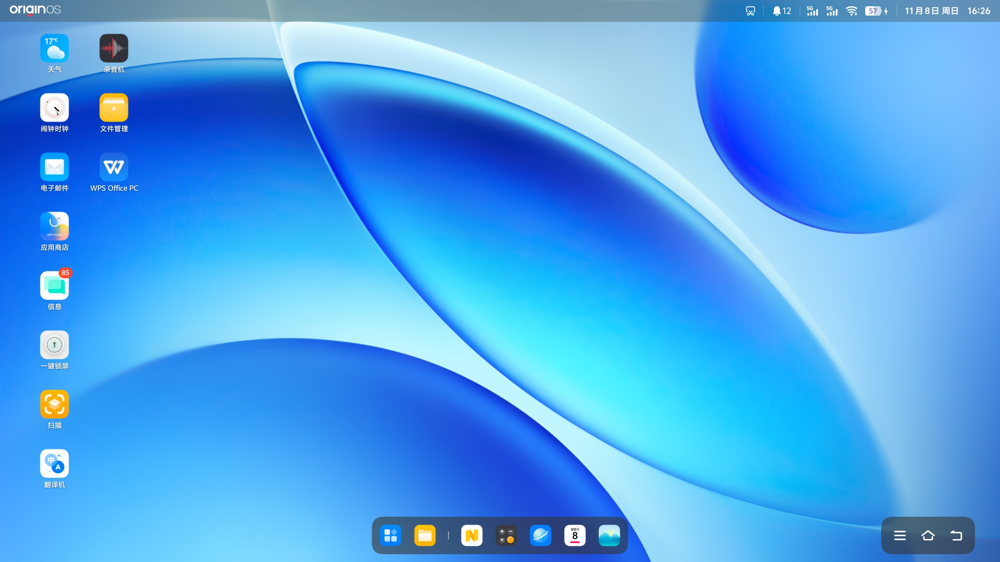
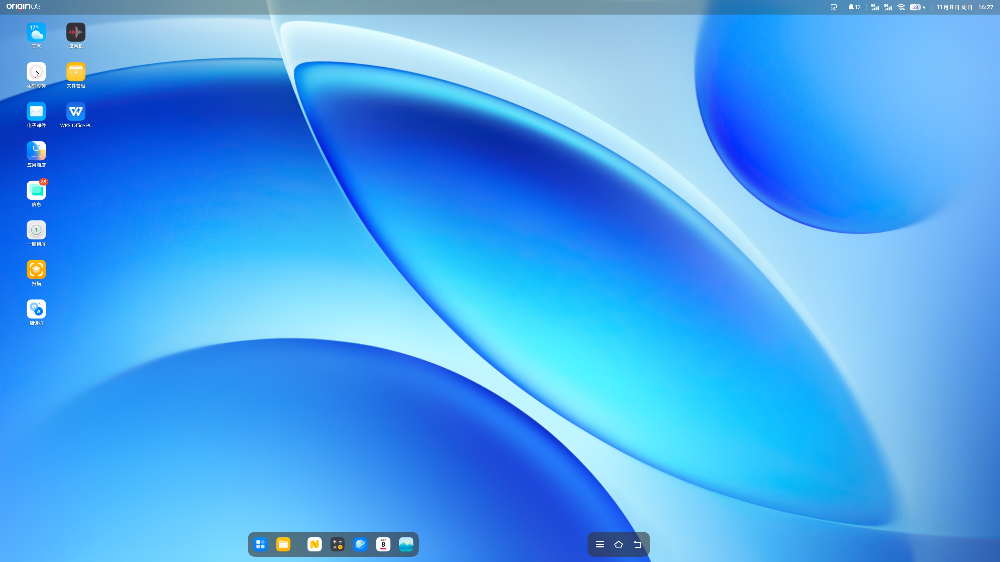
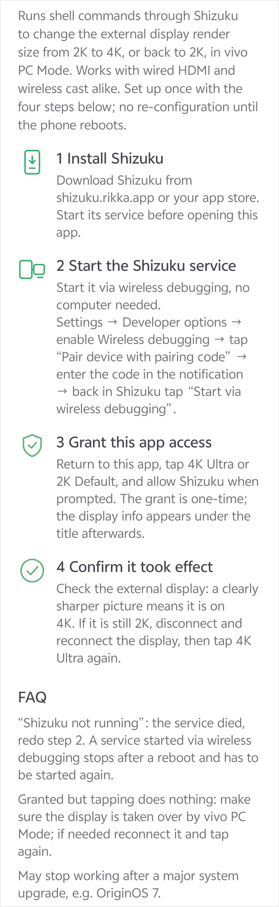
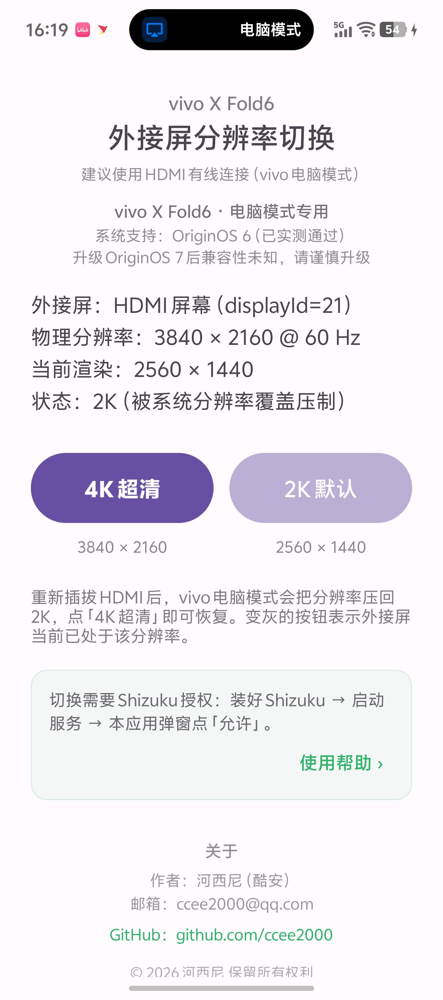
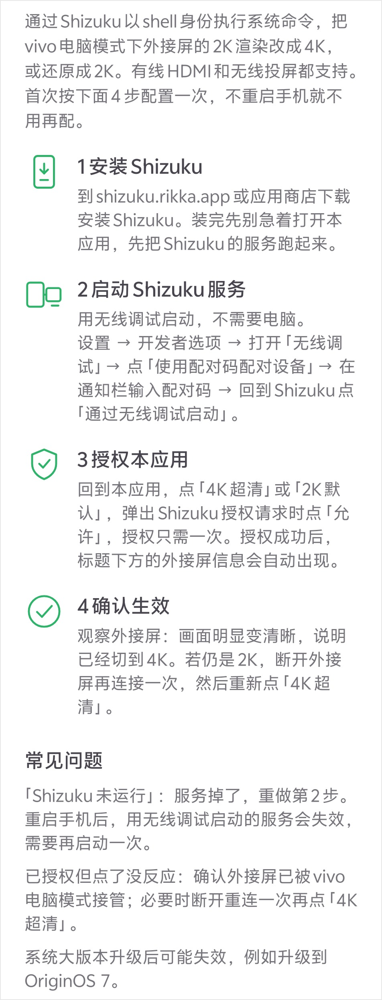

**English** | [中文](#zh)

# X Fold6 Cast Assistant

A resolution switcher for external displays (wired or wireless) under vivo X Fold6 PC Mode.

> This is a personal hobby tool, built with AI assistance, mainly for my own vivo X Fold6. Shared as open source, no long-term maintenance guarantee.

## Introduction

In vivo X Fold6 PC Mode, an external display (wired HDMI or wireless cast) is locked to a 2K render size by the system. This app uses Shizuku to run shell commands and switch the external display render size to 4K, or restore it back to 2K.

The panel itself is 3840×2160 @ 60Hz, but the system only renders 2560×1440 by default. This tool restores what gets cut.

### Screenshots

**App UI (English build)**

**PC Mode on the external monitor (one 2K, one 4K)**

Same monitor (LECOO M3221PL, 3840×2160 @ 60Hz), same HDMI cable, one tap apart. These two images are the monitor's own output, so their pixel size is the render size — compare the sharpness of the desktop icons and text directly:

| 2K default (system override) | 4K Ultra (after switching) |
| --- | --- |
|  |  |
| Render 2560 × 1440 (app shows state 2K, overridden by system) | Render 3840 × 2160 (app shows state 4K, native) |

### Built-in guide

4 steps to set up Shizuku, all on the phone, no desktop ADB; entry point is "Help ›" on the main screen.

## Compatibility

- Tested device: vivo X Fold6
- Tested OS: OriginOS 6
- Works with both wired HDMI and wireless cast in vivo PC Mode; 4K switching confirmed working over wireless cast too
- May stop working after system updates, e.g. upgrading to OriginOS 7

## Features

- One-tap switch: 4K Ultra (3840×2160) / Default 2K (2560×1440)
- Live status of the external display: physical resolution, current render size, state
- Built-in 4-step guide for Shizuku setup (wireless debugging only, no desktop ADB)
- After re-plugging HDMI the system falls back to 2K; tap "4K Ultra" to restore

## Usage

1. Install Shizuku (app store or shizuku.rikka.app)
2. Start the Shizuku service: Developer options → Wireless debugging → pair with code → "Start via wireless debugging" in Shizuku
3. Grant access: tap "4K Ultra" or "2K Default" and allow the Shizuku prompt (once only)
4. Verify: check whether the external display looks sharper; if it is still 2K, re-plug HDMI and tap again

The service started via wireless debugging stops after a reboot and has to be started again.

## Download

APKs are on the Releases page (v1.1). The Chinese and English builds are two separate packages that can be installed side by side; features are identical, only the UI language differs:

| Build | File | applicationId | UI language |
| --- | --- | --- | --- |
| Chinese | `XFold6_Cast_CN_v1.1.apk` | `com.test.virtual4k` | 中文 |
| English | `XFold6_Cast_EN_v1.1.apk` | `com.test.virtual4k.en` | English |

Direct links:

- Chinese: https://github.com/ccee2000/vivo-xfold6-cast-assistant/releases/download/v1.1/XFold6_Cast_CN_v1.1.apk
- English: https://github.com/ccee2000/vivo-xfold6-cast-assistant/releases/download/v1.1/XFold6_Cast_EN_v1.1.apk

## Notice

This app calls system display override APIs. It is not an official vivo feature and may break after major OS updates. For personal study and research use only.

## Author

- Hexini (Coolapk)
- Email: ccee2000@qq.com
- GitHub: https://github.com/ccee2000

## License

MIT

---

# X Fold6 投屏助手

> vivo X Fold6 电脑模式外接屏分辨率切换工具（有线 HDMI / 无线投屏）

本项目只是个人业余自用工具，借助 AI 辅助开发，优先适配我自己的 vivo X Fold6，开源分享，不保证长期维护。

## 介绍

vivo X Fold6 原生电脑模式下，外接显示器（有线 HDMI 或无线投屏）会被系统压到 2K 渲染。本应用通过 Shizuku 以 shell 身份执行系统命令，把外接屏渲染分辨率切到 4K，或者还原回 2K。

外接屏物理分辨率 3840×2160 @ 60Hz，系统默认只给 2560×1440 渲染，本工具就是把被压掉的那部分补回来。

### 界面预览

**App 界面（手机端，中文版）**

**外接显示器电脑模式（2K / 4K 各一张）**

同一台显示器（LECOO M3221PL，3840×2160 @ 60Hz）、同一条 HDMI 线，只差按一下按钮。下面两张是外接屏自己输出的画面，尺寸即渲染分辨率，可直接对比桌面图标与文字的清晰度差异：

| 2K 默认（被系统覆盖压制） | 4K 超清（切换后） |
| --- | --- |
|  |  |
| 渲染 2560 × 1440（App 显示：状态 2K，被系统分辨率覆盖压制） | 渲染 3840 × 2160（App 显示：状态 4K，原生物理分辨率） |

### 内置使用帮助

4 步配置 Shizuku，全部在手机上完成，不需要电脑 ADB，入口在主界面「使用帮助」。

## 适配说明

- 测试设备：vivo X Fold6
- 测试系统：OriginOS 6（已实测通过）
- 有线 HDMI 与无线投屏均支持，需在 vivo 电脑模式下使用；无线投屏切 4K 已实测可用
- 系统升级后可能失效，如：升级 OriginOS 7

## 功能

- 一键切换：4K 超清（3840×2160）/ 2K 默认（2560×1440）
- 主界面实时显示外接屏物理分辨率、当前渲染分辨率与状态
- 内置完整使用帮助（4 步配置 Shizuku，仅无线调试方式，不需要电脑 ADB）
- 重新插拔 HDMI 后系统会把分辨率压回 2K，点「4K 超清」即可恢复

## 使用步骤

1. 安装 Shizuku（应用商店或 shizuku.rikka.app）
2. 启动 Shizuku 服务：设置 → 开发者选项 → 打开「无线调试」→ 用配对码配对 → Shizuku 里「通过无线调试启动」
3. 授权本应用：点「4K 超清」或「2K 默认」，Shizuku 弹窗点「允许」（只需一次）
4. 确认生效：回到电脑模式观察外接屏是否变清晰，若仍是 2K，重新插拔 HDMI 后再点一次

重启手机后，用无线调试启动的服务会失效，需要重新执行第 2 步。

## 下载

APK 见本仓库 Releases 页（v1.1）。中文版、英文版是两个独立包，可以同时安装、互不影响，功能完全一致，只是界面语言不同：

| 版本 | 文件 | 包名 | 界面语言 |
| --- | --- | --- | --- |
| 中文版 | `XFold6_Cast_CN_v1.1.apk` | `com.test.virtual4k` | 中文 |
| 英文版 | `XFold6_Cast_EN_v1.1.apk` | `com.test.virtual4k.en` | English |

直链：

- 中文版：https://github.com/ccee2000/vivo-xfold6-cast-assistant/releases/download/v1.1/XFold6_Cast_CN_v1.1.apk
- 英文版：https://github.com/ccee2000/vivo-xfold6-cast-assistant/releases/download/v1.1/XFold6_Cast_EN_v1.1.apk

## 说明

本程序调用系统显示覆盖接口，非 vivo 官方功能，系统大版本升级后可能失效。仅用于个人学习研究。

## 作者

- 河西尼（酷安）
- 邮箱：ccee2000@qq.com
- GitHub：https://github.com/ccee2000

## License

MIT
