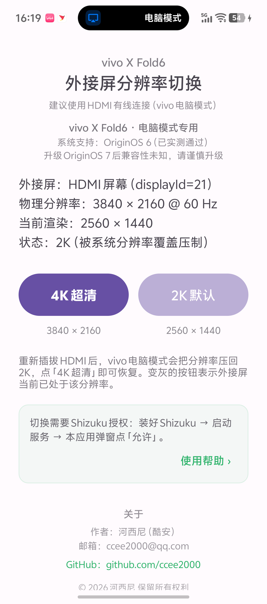
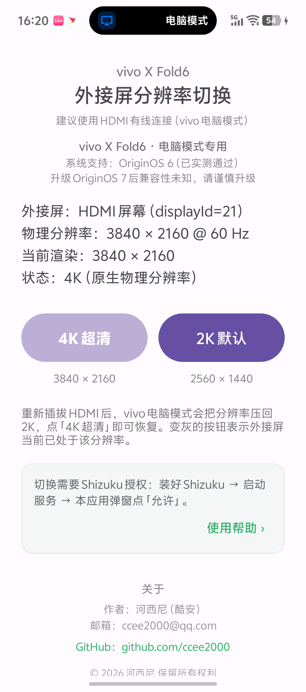
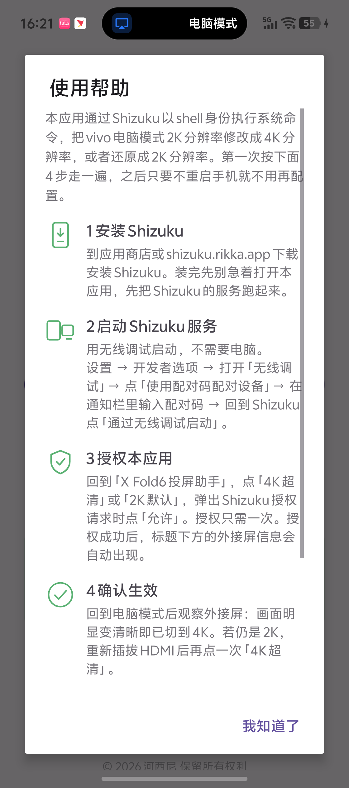

# X Fold6 Cast Assistant

A resolution switcher for wired external displays under vivo X Fold6 PC Mode.

> This is a personal hobby tool, built with AI assistance, mainly for my own vivo X Fold6. Shared as open source, no long-term maintenance guarantee.

## Introduction

In vivo X Fold6 PC Mode, an HDMI-connected external display is locked to a 2K render size by the system. This app uses Shizuku to run shell commands and switch the external display render size to 4K, or restore it back to 2K.

The panel itself is 3840×2160 @ 60Hz, but the system only renders 2560×1440 by default. This tool restores what gets cut.

### Screenshots (2K vs 4K)

Same monitor, same HDMI cable, one tap apart:

| 2K default (system override) | 4K Ultra (after switching) |
| --- | --- |
|  |  |
| Render 2560 × 1440, state: 2K (overridden by system) | Render 3840 × 2160, state: 4K (native) |

### Built-in guide

4 steps to set up Shizuku, all on the phone, no desktop ADB:

## Compatibility

- Tested device: vivo X Fold6
- Tested OS: OriginOS 6
- Wired HDMI PC Mode only; wireless cast is not supported
- May stop working after system updates, e.g. upgrading to OriginOS 7

## Features

- One-tap switch: 4K Ultra (3840×2160) / Default 2K (2560×1440)
- Live status of the external display: physical resolution, current render size, state
- Built-in 4-step guide for Shizuku setup (wireless debugging only, no desktop ADB)
- After re-plugging HDMI the system falls back to 2K; tap "4K Ultra" to restore

## Usage

1. Install Shizuku (app store or shizuku.rikka.app)
2. Start the Shizuku service: Developer options → Wireless debugging → pair with code → "Start via wireless debugging" in Shizuku
3. Grant access: tap "4K Ultra" or "2K Default" and allow the Shizuku prompt (once only)
4. Verify: check whether the external display looks sharper; if it is still 2K, re-plug HDMI and tap again

The service started via wireless debugging stops after a reboot and has to be started again.

## Download

See the Releases page of this repository: `XFold6_Cast_CN_v1.0.apk` (package `com.test.virtual4k`, Chinese UI).

## Notice

This app calls system display override APIs. It is not an official vivo feature and may break after major OS updates. For personal study and research use only.

## Author

- Hexini (Coolapk)
- Email: ccee2000@qq.com
- GitHub: https://github.com/ccee2000

## License

MIT
